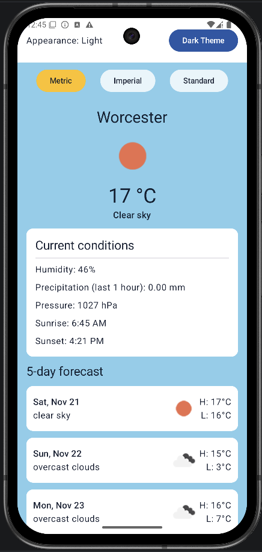
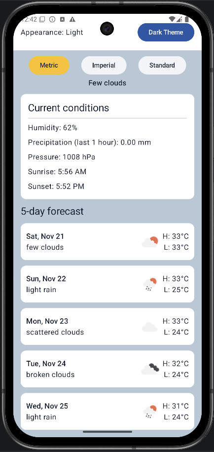
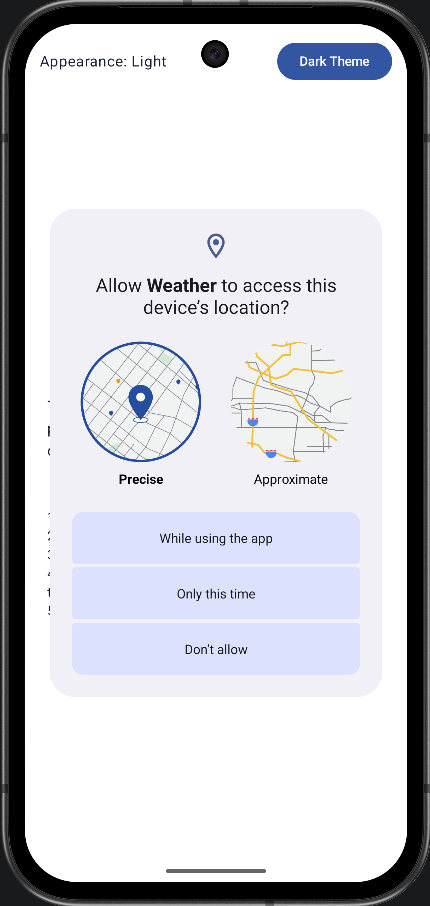

# 🌤️ Weather App

A modern Android weather application built with **Kotlin** and **Jetpack Compose**. The app retrieves weather information based on the user's current location and presents current conditions and upcoming forecasts through a clean, dynamic interface.

## 📸 Screenshots

|                Current Weather                 | Weather Forecast |
|:----------------------------------------------:|:---:|
|  |  |

|             Dark Mode              |         Location Screen          |
|:----------------------------------:|:--------------------------------:|
|  |  |

## 📱 Features

- **Location-Based Weather:** Retrieves the user's geographic location using Android location services.
- **Current Weather:** Displays current temperature, weather conditions, humidity, atmospheric pressure, sunrise, and sunset.
- **Weather Forecast:** Shows upcoming weather forecasts organized by day.
- **Dynamic Weather UI:** Adapts the app's background and text colors based on weather conditions and time of day.
- **Temperature Units:** Switches between Celsius, Fahrenheit, and Kelvin.
- **Light and Dark Themes:** Supports both light and dark application themes.
- **Location Permissions:** Handles runtime location permissions and guides users through enabling location access.

## 🛠️ Tech Stack

| Technology | Purpose |
|---|---|
| Kotlin | Primary programming language |
| Jetpack Compose | Declarative UI development |
| Material 3 | UI components and styling |
| Android ViewModel | UI state management |
| Kotlin Coroutines | Asynchronous operations |
| StateFlow | Reactive state updates |
| Google Play Services Location | Device location retrieval |
| OpenWeather API | Weather data and forecasts |
| Gradle | Build automation |

## 🏗️ Architecture

The application follows an MVVM-inspired architecture to separate UI components, business logic, and data access.

```text
app/
└── src/main/java/wpics/weather/
    ├── MainActivity.kt
    ├── HomeScreen.kt
    │
    ├── model/
    │   ├── location/
    │   │   ├── Coordinate.kt
    │   │   └── PlayServicesLocationRepository.kt
    │   │
    │   └── weather/
    │       ├── WeatherRepository.kt
    │       ├── WeatherResponse.kt
    │       └── ...
    │
    ├── ui/
    │   ├── WeatherScreen.kt
    │   ├── components/
    │   │   ├── HomeScreenComponents.kt
    │   │   └── WeatherScreenComponents.kt
    │   └── theme/
    │
    └── viewmodel/
        ├── LocationViewModel.kt
        └── WeatherViewModel.kt
```

**Key design principles:**

- **Separation of concerns:** UI, location handling, and weather data retrieval are organized into separate layers.
- **Reactive UI:** StateFlow allows the UI to respond automatically to state changes.
- **Lifecycle-aware state management:** ViewModels manage UI-related data across configuration changes.
- **Reusable components:** Common UI elements are extracted into composable functions.

## 🚀 Getting Started

### Prerequisites

- Android Studio
- JDK 21
- Android SDK
- An OpenWeather API key
- An Android emulator or physical Android device

### 1. Clone the repository

```bash
git clone https://github.com/YOUR_USERNAME/YOUR_REPOSITORY.git
cd YOUR_REPOSITORY
```

### 2. Configure your API key

Obtain an API key from [OpenWeather](https://openweathermap.org/api).

Add the following entry to your project's `local.properties` file:

```properties
WEATHER_API_KEY=your_api_key_here
```

Make sure your Gradle configuration reads this property and exposes it to your application through `BuildConfig`.

**Security note:** Do not commit `local.properties` or expose your API key in your source code. Keep your local configuration out of version control.

### 3. Build and run

1. Open the project in Android Studio.
2. Allow Gradle to sync.
3. Select an Android emulator or connect a physical device.
4. Run the application.

### 4. Grant location permissions

When prompted, allow location access so the application can retrieve your current location and load the corresponding weather information.

## 🌐 API Integration

This application uses the [OpenWeather API](https://openweathermap.org/api) to retrieve weather information.

The application uses weather data to populate:

- Current weather conditions
- Temperature and humidity
- Atmospheric pressure
- Sunrise and sunset times
- Multi-day weather forecasts

Weather data is retrieved asynchronously and exposed to the UI through ViewModels.

## 📚 What I Learned

Building this application provided hands-on experience with:

- Developing Android applications using Kotlin and Jetpack Compose.
- Implementing the MVVM architecture.
- Managing asynchronous tasks with Kotlin Coroutines.
- Building reactive interfaces with StateFlow.
- Integrating third-party REST APIs.
- Handling Android runtime permissions and location services.
- Designing reusable and adaptive UI components.
- Managing application configuration and API credentials.

## 📄 License

This project is available under the MIT License. See the `LICENSE` file for details.

---

**Built with Kotlin and Jetpack Compose.**